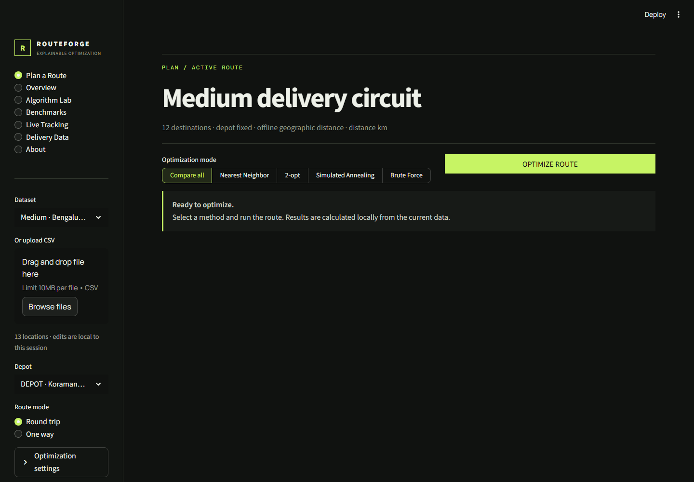
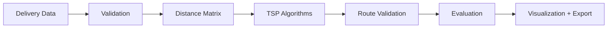

# ROUTEFORGE — AI Delivery Route Optimizer

ROUTEFORGE is an explainable, offline-first delivery route planning laboratory. It accepts a depot and delivery destinations, validates geographic data, builds a Haversine distance matrix, runs four Python-native TSP algorithms, visualizes the resulting route on Google Maps or an offline coordinate plot, and produces reproducible comparisons and exports.

The project is designed for a B.Tech AI demonstration without reducing the work to a toy dashboard: algorithms are separately testable, exact and heuristic claims are clearly distinguished, unsafe factorial work is blocked, and every metric shown in the interface comes from an actual run.

## Screenshot



## Why it exists

An inefficient stop sequence increases total geographic distance and operational effort. ROUTEFORGE makes that optimization problem inspectable: a student or operations analyst can compare a greedy baseline, an exact small-instance benchmark, deterministic local search, and stochastic metaheuristic search under the same route constraints.

## Features

- Required CSV upload plus manual row editing and deletion; no delivery locations are preloaded.
- Coordinate, required-field, duplicate-ID, and numeric validation.
- Round-trip and one-way routes with an optional fixed final destination.
- Optional OSRM driving-distance, driving-time, and road-geometry routing.
- Explicit address geocoding with Nominatim rate limiting, caching, and attribution.
- Optional TomTom live-traffic timing with a user-provided session-only API key.
- GPS telemetry tracking from uploads or real HTTP JSON/CSV device feeds.
- Distance, fastest-route, and priority-weighted arrival objectives.
- ETAs that include road/assumed travel time and destination service duration.
- Nearest Neighbor, guarded Brute Force, 2-opt, and seeded Simulated Annealing.
- Google Maps JavaScript basemap with numbered stops, depot styling, route lines, and tracking markers.
- Offline Plotly coordinate-map fallback—no tile server, API key, or Internet connection required.
- Route timeline with explicit depot return, leg distance, and cumulative distance.
- Exact optimality gap for small instances; no false optimum claims on larger ones.
- Algorithm decision/convergence histories and student-friendly explanations.
- CSV/JSON route exports and a repeatable benchmark runner.
- Premium dark control-room interface with centralized visual tokens.

## Technology

Python 3.12, Streamlit, Pandas, NumPy, Plotly, NetworkX (available for future graph routing), and pytest.

## Architecture



See [architecture](docs/architecture.md), [algorithm notes](docs/algorithms.md), [experiments](docs/experiments.md), and the [design system](docs/design-system.md).
Provider setup and data contracts are documented in [live integrations](docs/integrations.md).

## Install and run

```bash
python -m venv .venv
# Windows
.venv\Scripts\activate
python -m pip install -r requirements.txt
streamlit run app.py
```

Open the local URL printed by Streamlit (normally `http://localhost:8501`). Core optimization requires no paid API, account, API key, traffic feed, or map service.

### Enable Google Maps

Enable **Maps JavaScript API** in a Google Cloud project with billing configured, create a browser API key, and restrict it to Maps JavaScript API plus the web referrers that host ROUTEFORGE. Then either:

```powershell
$env:GOOGLE_MAPS_API_KEY = "your-restricted-browser-key"
streamlit run app.py
```

or copy `.streamlit/secrets.toml.example` to `.streamlit/secrets.toml` and replace the placeholder. You can also enter a key in the sidebar for the current Streamlit session. The real secrets file is ignored by Git. Google Maps is a display layer: select **Road network · OSRM** and load its matrix when the optimization itself should use road distance and duration rather than Haversine estimates.

## CSV schema

```csv
location_id,name,latitude,longitude,priority,service_duration
DEPOT,Koramangala Hub,12.9352,77.6245,1,0
BLR-01,Indiranagar,12.9784,77.6408,2,12
```

`location_id`, `name`, `latitude`, and `longitude` are required. IDs must be unique. Latitude must be between −90 and 90, longitude between −180 and 180. Priority and service duration are optional and non-negative. Multiple locations may share coordinates.

## Typical workflow

1. Upload a delivery CSV; the application validates it before route controls are enabled.
2. Select the depot and round-trip or one-way mode.
3. Set the seed, annealing iterations, and exact-search safety limit.
4. Run one algorithm or compare all applicable methods.
5. Inspect the Google Maps or offline route view, timeline, measured metrics, and explanation.
6. Export the selected route or move to the Algorithm Lab to inspect how each method searched.

### Using live and road data

1. In **Distance model**, choose **Road network · OSRM** and explicitly load the matrix. A custom OSRM server may be supplied.
2. Use **Delivery Data → Add a destination from an address** for an explicit, cached geocoding request.
3. Expand **Live traffic** after optimization and provide a TomTom API key to request current traffic timing. Keys are not persisted.
4. Open **Live Tracking**, download the telemetry example if needed, and upload telemetry or configure a real HTTP JSON/CSV fleet endpoint.

External integrations are optional. Network errors produce user-facing messages and the offline Haversine workflow remains available. See [integration documentation](docs/integrations.md) for provider limitations and privacy notes.

## Algorithms and guarantees

| Method | Role | Guarantee |
|---|---|---|
| Nearest Neighbor | Fast greedy baseline | No global optimum guarantee |
| Brute Force | Small-instance exact benchmark | Exact only when the permitted space is fully enumerated |
| 2-opt | Deterministic route improvement | Never accepts a worsening swap; local optimum only |
| Simulated Annealing | Seeded stochastic exploration | Can escape local optima; no global guarantee |

Haversine distance is great-circle distance, not road-driving distance. Nearest Neighbor is a TSP construction heuristic; it is not Greedy Best-First Search.

## Tests

```bash
python -m pytest -q
```

The suite checks distance math, symmetry, zero distances, validation failures, duplicate coordinates, route constraints, exact optimality, non-worsening 2-opt behavior, annealing reproducibility, brute-force limits, metric formulas, exports, and evaluation consistency.

## Reproducible evaluation

```bash
python scripts/run_benchmarks.py
```

This generates machine-readable CSV and JSON in `benchmark_results/`. Small instances receive an exact reference. Larger instances compare heuristics without claiming the unknown global optimum. Simulated Annealing is repeated over documented seeds. Runtime figures are machine- and environment-dependent.

### Measured reference run

Generated locally on October 11, 2026 with Python 3.12 and 3,000 annealing iterations:

| Dataset | Nearest Neighbor | 2-opt | Simulated Annealing | Exact optimum |
|---|---:|---:|---:|---:|
| Small (5 destinations) | 25.36 km | 24.92 km | 24.92 km | 24.92 km |
| Medium (12 destinations) | 97.62 km | 77.44 km | 77.44 km | Not evaluated |
| Large (24 destinations) | 209.32 km | 170.57 km | 173.27 km | Not evaluated |

These values are generated outputs, not claims that the medium or large heuristic routes are globally optimal. Exact timings and full-precision measurements are in [`benchmark_summary.csv`](benchmark_results/benchmark_summary.csv) and the parameters, environment, and repeated seeded runs are in [`benchmark_results.json`](benchmark_results/benchmark_results.json).

## Design process

The connected MagicPath integration was used to render and inspect a dashboard exploration before implementation. The final Streamlit design adopts its charcoal control-room foundation, acid-lime route/action accent, strong map hierarchy, compact route timeline, and evidence-led explanation panel. Figma connectivity was checked; the available plan reported a View seat, so no Figma artifact is claimed.

## Limitations

- Offline distances are geographic straight-line estimates. OSRM adds road topology but does not guarantee live traffic; TomTom traffic requires a valid user key.
- Brute Force is intentionally limited because runtime grows factorially.
- 2-opt and Simulated Annealing are heuristic; they may miss the global optimum.
- The optional A*/Greedy Best-First road-graph extension is not included in the core release so the tested TSP scope remains focused.
- Web fonts improve presentation when reachable, but the app remains usable with local fallbacks.
- GPS tracking reports the latest received telemetry and proximity; it cannot prove a parcel was delivered without an authoritative delivery event.

## Future work

Add opt-in road-network adapters, capacity and time-window constraints, richer local-search neighborhoods, a graph-routing teaching module, and route persistence—while keeping the offline educational core available.

## License

MIT. See [LICENSE](LICENSE).
