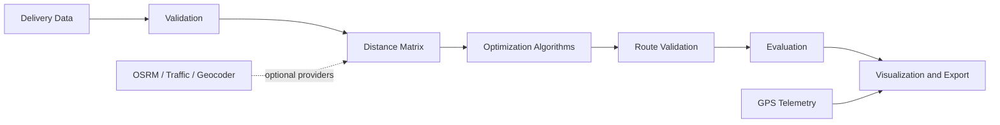

# Architecture

ROUTEFORGE separates input handling, domain models, algorithms, evaluation, presentation, and export. Algorithms receive only a NumPy distance matrix and explicit route constraints, so they remain independently testable and are not coupled to Streamlit.

## Modules

- `models.py`: immutable locations and route constraints plus algorithm result records.
- `validation.py` and `data_loader.py`: user-facing CSV/schema validation and local samples.
- `distance.py`: validated Haversine distances and symmetric matrix construction.
- `route_utils.py`: shared route distance and invariant checks.
- `algorithms/`: four Python-native TSP solvers with a common result contract.
- `evaluation.py`: comparison metrics, exact benchmarks, repeated annealing runs, environment metadata.
- `visualization.py` and `export_utils.py`: offline Plotly output and machine-readable route exports.
- `integrations.py`: bounded OSRM, Nominatim, and TomTom provider adapters.
- `tracking.py`: timestamped GPS feed validation and latest-position analysis.
- `objectives.py`: distance, travel-time, and priority-weighted arrival scoring plus ETAs.
- `ui/`: design tokens, reusable presentation components, and Streamlit page composition.

## Constraint contract

Every route starts at the selected depot. A round trip repeats the depot once at the end. A one-way route visits every location once and may reserve a fixed endpoint. All algorithms are validated against the same contract before a result is returned.
